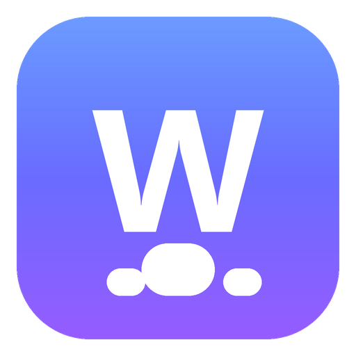

<div align="center">



# WIN MAC

**A macOS-style dock and menu bar for Windows 11.**  
Written from scratch in Rust on plain Win32 — no Windhawk, no Explorer patching.

[](https://github.com/Maxodus126/WinMac/releases/latest)
[](https://github.com/Maxodus126/WinMac/releases)
[](LICENSE)
[](https://www.microsoft.com/windows/windows-11)
[](https://www.rust-lang.org/)
[](https://maxodus126.github.io/WinMac/)

*Media placeholder — screenshots and video will be added here.*

<br>

**[Download for Windows 11](https://github.com/Maxodus126/WinMac/releases/latest) · [Install guide](INSTALL.md) · [View Website](https://maxodus126.github.io/WinMac/) · [Built from source](#build-from-source)**

</div>

---

## Overview

WIN MAC replaces the Windows 11 taskbar with a **Liquid Glass dock** and a **macOS-style menu bar** — rendered natively, not injected into Explorer. It is a rebranded, maintained fork of [MacDock](https://github.com/GodrezJr2/MacDock) by [@GodrezJr2](https://github.com/GodrezJr2), with English as the default language and a new WIN MAC identity.

**Highlights:** cosine-falloff icon magnification · genie minimize · real window capture behind the glass · Spotlight (Alt+Space) · macOS-style Alt+Tab · Control Center · battery power metrics · desktop widgets · live AI usage for Claude Code & Codex — all in a ~1 MB native executable using **0% CPU at idle**.

---

## Features

### The dock

*Screenshot coming soon — will be added.*

- **Magnification** that follows the pointer (cosine falloff, smoothed per frame)
- **Genie** minimize into the app icon — and back out on restore
- Launch **bounce** and attention bounce when an app flashes
- Running dots, hover labels and red **unread badges**
- Drag to reorder / remove; right-click for windows, Keep in Dock, Show in Explorer, Quit
- **Auto-hide**, with icons shrinking at screen edges
- macOS-style squircle tiles; right-click → **Change Icon…** for custom images
- **Drop files** onto an app icon to open, or onto Trash to recycle
- **Recent apps** and a **Downloads stack** by the Trash

### The genie

*Screenshot coming soon — will be added.*

The window is snapshotted and drawn as a 48-row mesh by WIN MAC's own scanline rasterizer (bilinear, anti-aliased, rows split across threads), then poured into its icon. Restore plays it backwards. Windows' own minimize animation is disabled while WIN MAC runs.

### Menu bar & flyouts

- Front app in bold with **File / Edit / View / Window / Help** menus sending real shortcuts (Ctrl+S, Ctrl+Z…)
- Battery, Wi-Fi, **Spotlight** (Alt+Space), Control Center and a clock with a **calendar**
- System menu: Auto Hide Dock, Quit, Check for Updates (only `api.github.com`; nothing auto-downloads; a blue dot marks new releases)
- **Control Center:** Wi-Fi/Bluetooth, Dark Mode, Windows power mode, brightness, volume, now-playing, and a `^` tray host
- **Battery flyout** with real numbers: charge, wear, cycles, CPU package power (RAPL), NVIDIA GPU power (NVML) and rest
- **AI usage** for Claude Code & Codex: ring of the nearest limit, tok/s burn rate, 5/30-min and 24h charts, per-session details — read from local logs, no telemetry by default. Update checks hit the GitHub API and can be disabled in Settings (see [Privacy](INSTALL.md#kebijakan-privasi-ringkas)).

*Screenshot coming soon — will be added.*

### Apps window, Spotlight & Alt+Tab

- **Apps window** — a macOS 26–style Launchpad replacement with live search, category chips and recents
- **Spotlight** — a glass capsule that grows into results as you type (apps first, then web search)
- **Alt+Tab like Cmd+Tab** — one icon per app, most-recent-first, dark frosted panel; quick tap flips to the previous app; Esc cancels, Q quits, H minimizes

*Screenshot coming soon — will be added.*

### Desktop widgets

*Screenshot coming soon — will be added.*

Four frosted macOS-style widgets top-right: analog clock, date, battery ring and system meters. They live under every window, redraw every 5 s only when a value changed, and click through to Clock, Calendar, battery settings or Task Manager.

### It stays out of the way

- Dock and menu bar are real **AppBars** — maximized windows stop at them
- Fullscreen games hide both, suspend the render loop and remove the mouse hook (measured **0.00% CPU / 17 MB**)
- Idle on desktop: ~0.4% of one core, ~80 MB private memory (mostly one shared Direct3D device)
- Nothing redraws unless something moves

---

## Install

### Download (recommended)

Grab `winmac.exe` from the **[latest release](https://github.com/Maxodus126/WinMac/releases/latest)** and run it. Windows 11 only — nothing else to install. Verify with the provided `winmac.exe.sha256`.

### Build from source

1. Install Rust from [rustup.rs](https://rustup.rs).
2. Switch to the GNU toolchain (no Visual Studio Build Tools needed):
   ```powershell
   rustup default stable-x86_64-pc-windows-gnu
   ```
3. Build and run:
   ```powershell
   git clone https://github.com/Maxodus126/WinMac.git
   cd WinMac
   cargo build --release
   .\target\release\winmac.exe
   ```

The first build compiles the dependencies (a few minutes). The result is one small native exe.

WIN MAC hides the Windows taskbar while running and restores it on quit.
- **Quit:** Windows logo in the menu bar → **Quit WIN MAC**
- **If killed and taskbar stays hidden:** `winmac.exe --restore`
- **Start with Windows:** Windows logo → **Open WIN MAC at Login**

---

## Configuration

Settings live in `%APPDATA%\WinMac\config.json`, created on first run. The Settings window (menu bar → gear) exposes every option with live preview.

| Key | Default | What it does |
| --- | --- | --- |
| `Pinned` | Explorer, Apps, Chrome, Outlook, Terminal, VS Code, Discord, Settings | Dock items (`shell:AppsFolder\<AppID>`, `.lnk`, `.exe`, or `winmac:apps`) |
| `LaunchpadStyle` | `"apps"` | `"apps"` (Apps window) or `"classic"` (full-screen Launchpad) |
| `IconSize` / `Magnify` | `52` / `1.75` | Icon size at rest and under the pointer |
| `AutoHide` / `HideDelay` | `false` / `350` | Slide-away dock and its linger time |
| `Genie` / `GenieDuration` | `true` / `560` | Genie animation and length (ms) |
| `IconTiles` / `Badges` | `true` / `true` | Squircle tiles / unread badges |
| `MenuBar` / `TrayIcons` | `true` / `true` | Menu bar / `^` tray host |
| `HideTaskbar` | `true` | Cover the Windows taskbar with the dock while WIN MAC runs |
| `DesktopWidgets` / `DownloadsStack` / `ShowRecents` | `true` | Widgets, Downloads stack, last-3 recents |
| `AppSwitcher` | `false` | macOS-style Alt+Tab (off = Windows switcher) |
| `IconOverrides` | `{}` | Per-item custom icons (right-click → Change Icon…) |
| `AiUsage` | `true` | Claude Code / Codex usage item |
| `ClaudeUsageOAuth` / `ClaudeLimit5h` | `false` / `null` | Real Anthropic limits via local login, or a local-token estimate |

A crash writes `%APPDATA%\WinMac\panic.log` and restores the taskbar.

---

## How it works

<details>
<summary><b>Liquid Glass without a blur API</b></summary>
Windows ignores window regions for layered windows, so accent blur behind a rounded plate showed as a black square. WIN MAC captures the windows beneath the plate live with Windows Graphics Capture (one capture per window; wallpaper where none), bends them inward near the rim like a lens, and repaints at most 30×/s — a video behind the dock costs ~0.1 s CPU/s.
</details>

<details>
<summary><b>A genie with no flash</b></summary>
A low-level mouse hook on its own thread sees the title-bar minimize press, pre-draws the first frame from a fresh snapshot and shows the overlay from the hook itself — the animation is already up as the window disappears. Only the mesh bounding box is redrawn. Snapshots are shrunk off-thread and saved to disk so a restart can restore with animation.
</details>

<details>
<summary><b>Unread badges & battery power</b></summary>
Badges are the max of a `(N)` title prefix and Action Center toasts (read via the system's `winsqlite3.dll`). Battery breakdown reads CPU package energy through the Windows Energy Meter Interface and GPU power through NVML (NVIDIA), learning the "rest" while unplugged — no admin, sleeping GPUs stay asleep.
</details>

### Performance: Rust vs the original C# build

| Metric | C# / WPF | Rust (WIN MAC) |
| --- | --- | --- |
| Private memory | 320–379 MB | **12.9 MB** |
| CPU idle | 0.04–0.6% | **0%** |
| CPU while magnifying | 2.0–2.3% | **1.65%** |
| Threads | 21–26 | **11** |
| On disk | 30 MB + .NET runtime | **~1 MB exe** |

The original C# version is kept at tag [`csharp-final`](https://github.com/GodrezJr2/MacDock/tree/csharp-final).

---

## Known limits

- Developed on one Windows 11 laptop (2560×1600, 125% scale, NVIDIA GPU); other setups may show rough edges — issues welcome.
- Dock and menu bar live on the primary monitor.
- GPU power requires an NVIDIA GPU; without one the breakdown shows CPU + rest.
- While the `^` tray flyout is open, a WinUI 3 app launched at that moment can fail to start (tray host registers its own `Shell_TrayWnd`).

---

## Credits & license

- Forked from [MacDock](https://github.com/GodrezJr2/MacDock) by [@GodrezJr2](https://github.com/GodrezJr2) (Jayson Christopher Lim), built with Claude Code as an AI pair programmer. WIN MAC keeps the original MIT license and attribution.
- macOS and the Dock are trademarks of Apple Inc. WIN MAC is independent and not affiliated with or endorsed by Apple.

**License:** [MIT](LICENSE) — free to use, modify and redistribute with attribution.
